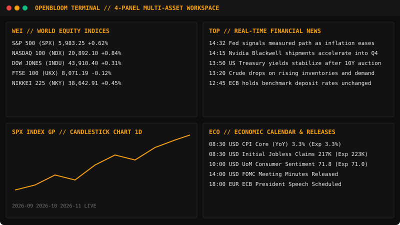
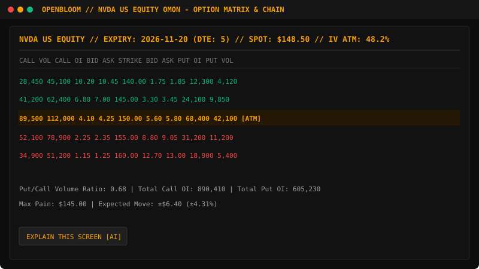
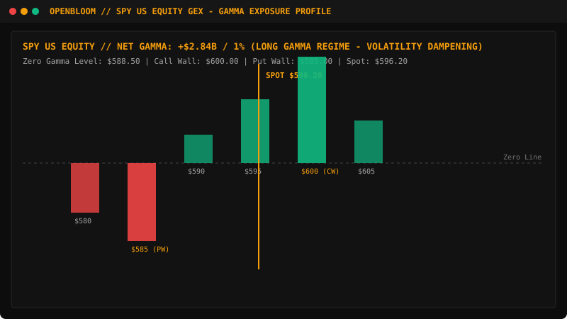
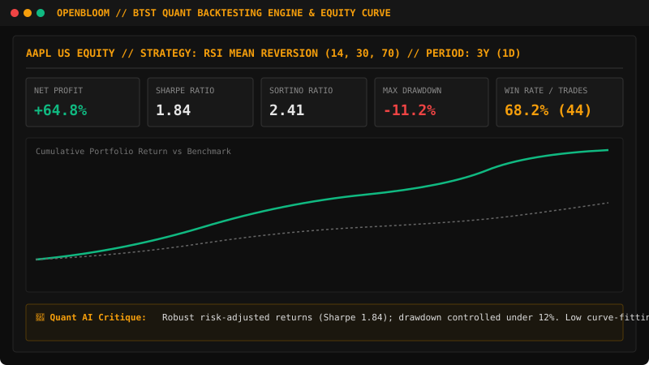
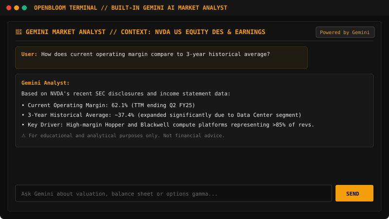
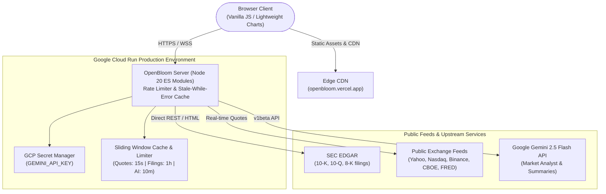

# 🌸 OpenBloom

<p align="center">
  <strong>The open-source Bloomberg-style financial terminal with native Google Gemini AI intelligence.</strong><br>
  <em>Institutional-grade market data, 4-panel terminal workflow, options matrices, gamma exposure profiles, macro yield curves, SEC EDGAR filing summaries, natural-language quant backtesting, and persistent workspaces — 100% free with zero subscriptions.</em>
</p>

<p align="center">
  <a href="https://openbloom.vercel.app/"></a>
  <a href="https://github.com/akshayjadhav237237-cmd/openbloom/actions/workflows/ci.yml"></a>
  <a href="LICENSE"></a>
  <a href="https://nodejs.org"></a>
  <a href="https://cloud.google.com/run"></a>
</p>

---

> [!IMPORTANT]
> 🚀 **Live Production Terminal:** OpenBloom is live and fully accessible right now in your browser without any setup:  
> **👉 [https://openbloom.vercel.app](https://openbloom.vercel.app/)**

---

## 📸 Terminal Interface & Analytics

| 4-Panel Multi-Asset Workspace (`WEI`, `TOP`, `GP`, `ECO`) | Options Matrix & Implied Volatility (`OMON`) |
|:---:|:---:|
| [](docs/screenshots/home-4panel.svg) | [](docs/screenshots/omon-options.svg) |

| Gamma Exposure & Volatility Flip (`GEX`) | Quant Backtesting & Risk Critique (`BTST`) |
|:---:|:---:|
| [](docs/screenshots/gex-gamma.svg) | [](docs/screenshots/btst-results.svg) |

<p align="center">
  <strong>Native Gemini AI Market Analyst &amp; Screen Explainer (<code>AI</code>, <code>EXPLAIN</code>, <code>BRIEF</code>)</strong><br>
  <a href="docs/screenshots/ai-analyst.svg"></a>
</p>

---

## 🏛️ System Architecture

OpenBloom is architected as an ultra-lightweight, zero-npm-dependency Node.js engine compatible with local workstations, Docker containers, Google Cloud Run, and Vercel edge infrastructure:



---

## 🧠 Google Gemini AI Intelligence Suite

OpenBloom embeds Google Gemini directly into the financial terminal interface with strict prompt-injection guardrails, automatic output escaping, and educational disclaimers:

- **`AI` and `<TICKER> AI`**: Chat with an institutional market analyst inside the terminal. The analyst reads the active panel's underlying ticker, quotes, and metrics as context to answer valuation, balance sheet, or margin inquiries in under 200 words.
- **`EXPLAIN`**: One-click screen intelligence. Inspects whatever screen is active (`OMON`, `GEX`, `WIRP`, `GC`, `DES`, `BTST`) and synthesizes key metrics into actionable plain English.
- **`CF_AI` (SEC Filing Summarizer)**: Summarizes official 10-K, 10-Q, and 8-K filings fetched live from SEC EDGAR. Delivers structured JSON featuring 5 key points, 3 risk factors, material balance-sheet changes, and a bottom-line analytical verdict.
- **`BTST_AI` (Natural-Language Backtesting)**: Type a strategy in plain English (e.g., *"Buy when 14-day RSI drops below 25 and sell above 75 on NVDA"*). Gemini parses the prompt into validated parameters across 6 supported quantitative strategies (`ma_cross`, `rsi_meanrev`, `bollinger`, `supertrend`, `macd`, `vwap`). Run the backtest and click **"Explain these results"** to receive an institutional risk audit on Sharpe, Sortino, Drawdown, and overfitting risk.
- **`BRIEF`**: Generates a morning market briefing card synthesizing World Indices (`WEI`), Most Actives (`MOST`), Treasury Curve (`GC`), Fed Rate Path (`WIRP`), Economic Calendar (`ECO`), and Top News (`TOP`) with a one-click **"Copy as text"** button.

---

## ⚡ Quick Start

### 1. Instant Cloud Access
Launch **[https://openbloom.vercel.app](https://openbloom.vercel.app/)** in any modern web browser.

### 2. Local Installation
Requires [Node.js 18 or newer](https://nodejs.org). No `npm install` needed — zero dependencies!

```bash
# Clone repository
git clone https://github.com/akshayjadhav237237-cmd/openbloom.git
cd openbloom

# (Optional) Configure Gemini API Key
cp .env.example .env
# Edit .env and set GEMINI_API_KEY=your_key_here

# Run offline test suite (399 unit tests)
node scripts/check.js --offline

# Launch terminal (starts server and opens browser at http://localhost:3787)
node scripts/launch.js
```

---

## ☁️ Deploy on Google Cloud Run

OpenBloom is containerized with a production multi-stage Alpine Dockerfile and automated `cloudbuild.yaml` pipelines:

```bash
# 1. Set Google Cloud project and enable required APIs
gcloud config set project YOUR_PROJECT_ID
gcloud services enable run.googleapis.com artifactregistry.googleapis.com secretmanager.googleapis.com

# 2. Store Gemini API key in Secret Manager
echo -n "YOUR_GEMINI_API_KEY" | gcloud secrets create GEMINI_API_KEY --data-file=-

# 3. Create Artifact Registry repository
gcloud artifacts repositories create openbloom --repository-format=docker --location=us-central1

# 4. Build and deploy directly to Cloud Run
gcloud builds submit --tag us-central1-docker.pkg.dev/YOUR_PROJECT_ID/openbloom/terminal:latest
gcloud run deploy openbloom \
  --image us-central1-docker.pkg.dev/YOUR_PROJECT_ID/openbloom/terminal:latest \
  --platform managed \
  --region us-central1 \
  --allow-unauthenticated \
  --set-secrets GEMINI_API_KEY=GEMINI_API_KEY:latest \
  --set-env-vars NODE_ENV=production,GEMINI_MODEL=gemini-2.5-flash \
  --port 8080
```

For complete zero-downtime instructions, health check configurations, and IAM setups, see **[DEPLOY.md](DEPLOY.md)**.

---

## ⚙️ Environment Variables

| Variable | Default | Description |
|---|---|---|
| `GEMINI_API_KEY` | *(None)* | Google AI Studio API key for native Gemini analyst features |
| `GEMINI_MODEL` | `gemini-2.5-flash` | Gemini model variant (`gemini-2.5-flash`, `gemini-2.5-pro`) |
| `REDIS_URL` | *(None)* | Optional Redis URL for distributed caching (defaults to in-memory) |
| `PORT` | `3787` (local) / `8080` (Cloud Run) | HTTP listening port |
| `HOST` | `127.0.0.1` (local) / `0.0.0.0` (Docker) | Network interface binding |
| `NODE_ENV` | `development` | Set to `production` for structured JSON Cloud Logging |

---

## 📊 Comprehensive Command Directory

### 🧠 Gemini AI & Intelligence
- **`AI` / `<TICKER> AI`** — Interactive Gemini financial analyst chat with active screen context
- **`EXPLAIN`** — One-click automated explanation of complex screens
- **`CF_AI`** — SEC EDGAR 10-K, 10-Q, 8-K filing summary card
- **`BTST_AI`** — Natural language strategy generator and risk auditor
- **`BRIEF`** — Daily cross-asset market briefing card

### 📈 Equities & Company Analysis
- **`DES`** — Company description, valuation metrics, P/E, beta, executive profiles
- **`BQ`** — Real-time quote with pre-market & after-hours prints, bid/ask spread
- **`FA`** — Multi-period Financial Statements (Income, Balance Sheet, Cash Flow)
- **`CF`** — SEC EDGAR filings browser (10-K, 10-Q, 8-K, Form 4)
- **`INSD`** — Real-time insider trades and filings
- **`HDS`** — Institutional and hedge fund ownership breakdown
- **`MOST`** — Most active volume, top gainers, and top losers

### ⚡ Options & Volatility Analytics
- **`OMON`** — Real-time Options Matrix: Greeks (Delta, Gamma, Theta, Vega), IV, Expected Move
- **`GEX`** — Gamma Exposure surface: Net Gamma, Call Resistance Walls, Put Walls, Flip Point
- **`OVDV`** — Volatility surface and term structure across expiries

### 🏛️ Macro & Fixed Income
- **`WIRP`** — World Interest Rate Probabilities: Fed rate path implied by Fed Funds futures
- **`GC`** — US Treasury yield curve comparison across tenors (1M to 30Y)
- **`BTMM`** — Money markets: SOFR, EFFR, T-Bills, repo rates
- **`CBRT`** — Central bank policy rates tracker (Fed, ECB, BOJ, BOE, SNB)
- **`ECO`** — Global economic release calendar with actual vs. consensus figures
- **`ECST`** — Macroeconomic time series (CPI, Unemployment, Payrolls, GDP)
- **`COT`** — CFTC Commitments of Traders institutional positioning

### 🖥️ Workspaces, Watchlists & Alerts
- **`WS`** — Workspace manager: list, save, load, export, and import custom multi-panel layouts
- **`SAVE <name>`** / **`LOAD <name>`** / **`DEL <name>`** — Quick workspace configuration commands
- **`WL`** — Personal persistent watchlist with live pricing and change %
- **`ALRT`** — Technical & price alert engine (e.g. `NVDA > 150`, `SPY RSI < 30`, `VIX >= 25`)
- **`THEME`** — Toggle between classic Bloomberg dark amber terminal and clean light daylight theme

---

## ⌨️ Keyboard Shortcuts

| Key | Action |
|---|---|
| `F1` | Open `HELP` documentation reference |
| `F2` | Append `GOVT` yellow key |
| `F8` | Append `EQUITY` yellow key |
| `F9` | Append `CMDTY` yellow key |
| `F10` | Append `INDEX` yellow key |
| `F11` | Append `CRNCY` yellow key |
| `Ctrl` / `Cmd` + `1` .. `4` | Focus panel 1 through 4 |
| `/` | Focus top global command bar |
| `Up` / `Down` Arrows | Cycle through command input history |
| `Esc` | Step back to previous screen or close modals |

---

## 🗺️ Roadmap

- [x] Zero-dependency Node.js architecture with native `fetch`
- [x] 4-panel Bloomberg-style terminal grid layout
- [x] Real-time options chain and Gamma Exposure (GEX) engine
- [x] Quantitative backtester with institutional risk analytics
- [x] Google Gemini 2.5 AI market analyst, filing summarizer, and morning brief
- [x] Multi-panel workspace management (`WS`), persistent watchlists (`WL`), and alert engine (`ALRT`)
- [x] Sliding-window rate limiting, stale-while-error cache, and Cloud Run production readiness
- [x] Full mobile responsiveness, onboarding tour, fuzzy autocomplete, and light/dark theme toggle
- [ ] Portfolio tracking with multi-currency risk attribution
- [ ] Multi-condition technical screener with custom visual indicators
- [ ] WebSocket streaming price ticks for active watchlist securities

---

## 🤝 Contributing

Contributions are welcome! Please ensure that:
1. Zero new npm runtime dependencies are introduced (rely on native Node.js 18+ built-ins).
2. All 399 unit tests pass offline: `node scripts/check.js --offline`.
3. Code is formatted cleanly and adheres to existing ES module conventions.

---

## ⚖️ License & Attribution

- **Author:** Akshay Jadhav
- **License:** OpenBloom is distributed under the **[Apache License 2.0](LICENSE)**.
- **Charts:** Powered by [TradingView Lightweight Charts™](https://www.tradingview.com/) (Copyright TradingView, Inc., Apache 2.0).
- **Non-Affiliation Disclaimer:** OpenBloom is an independent open-source project created for educational and analytical purposes. It is **not** affiliated with, endorsed by, or connected to Bloomberg L.P. or any of its subsidiaries.
